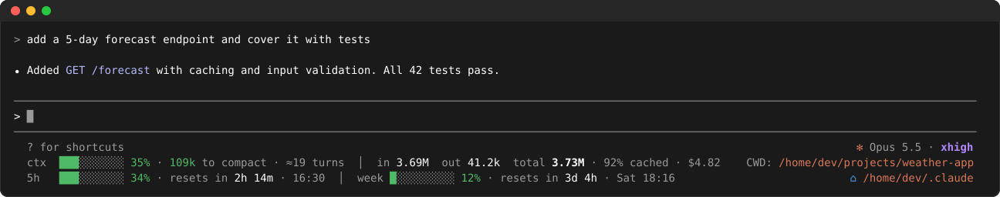
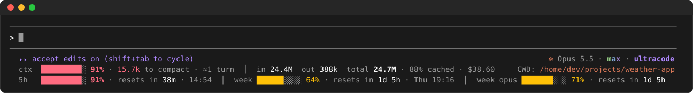
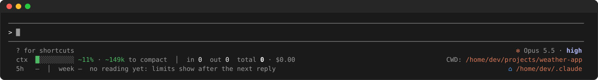
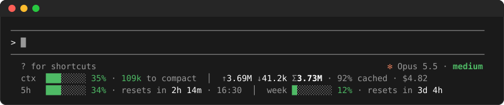

# usagebar

A Claude Code mod that draws two rows under the prompt in the terminal, and adds to the line above them.



## What it shows

- **The engine's line** (`auto mode on`, shortcuts): the current model and its effort at the right end, `✻ Opus 5.5 · xhigh`, coloured as the `/effort` picker colours them. It follows `/model` and `/effort`. A change to `xhigh` or `max`, or ultracode turning on, plays one short shimmer, then stands still (none with `prefersReducedMotion`).
- **ctx**: how full the context is compared with the auto-compact threshold, the tokens left before compaction, roughly how many turns that leaves at the recent pace, tokens in/out/total, the cache share and the session's cost, with `CWD:` and the session's directory at the right end.
- **limits**: one bar for each rate-limit window the API reports (5-hour, weekly, and any per-model weekly or spend limit), with how long until it resets and the local time it resets at, with ⌂ and Claude's config folder (`CLAUDE_CONFIG_DIR`, else `~/.claude`) at the right end.

The limits come from the last API response, so they update after each reply and show "no reading yet" before the first one. The reset countdowns refresh every 30 seconds. On narrow terminals the extras drop out first so the bars always fit.

## Screenshots

**Colours follow the pressure.** Bars go green, then amber from 60%, then red from 85%, for the context and for every limit window, including per-model weekly limits when the API reports them.



**Effort changes shimmer once.** Switching to `xhigh` or `max`, or turning ultracode on, plays one short pass in the colours the `/effort` picker uses, then stands still.



**Before the first reply.** The context fill is an estimate (`~`) until a response reports it, and the limits wait for their first reading.



**Narrow terminals.** Lower-priority pieces drop out first (turns left, the reset clock, the paths), and token counts switch to `↑ ↓ Σ`.



## Install

At the prompt of a Claude Code terminal session:

```
/plugin install usagebar --marketplace wannabemrrobot/claude-mods
```

Answer `y` to add the marketplace, then pick a scope. The footer shows up right away.

From a shell:

```
claude plugin install usagebar --marketplace wannabemrrobot/claude-mods
```

In the desktop app, where `/plugin` doesn't run: click **+** next to the prompt box → **Plugins** → **Add marketplace** with `wannabemrrobot/claude-mods` → **Add plugin**.

## Develop

Run it from a clone with `claude --plugin-dir /path/to/claude-mods/usagebar`.

`claude plugin validate .` · `claude plugin test .`
